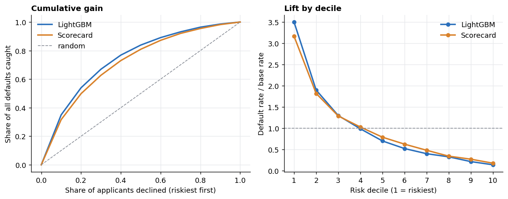

# Credit Default Risk Model

[](https://www.python.org/downloads/)
[](https://lightgbm.readthedocs.io/)
[](https://opensource.org/licenses/MIT)
[](https://www.repostatus.org/#active)

An end-to-end, reproducible credit default risk classifier based on the [Home Credit Default Risk dataset](https://www.kaggle.com/c/home-credit-default-risk). This project demonstrates the full lifecycle of an applied Machine Learning project in the Credit Risk domain: from multi-table data aggregation and robust feature engineering, to handling extreme class imbalances, and finally translating statistical outputs into business-actionable threshold strategies.

---

## Executive Summary

**Finding.** Home Credit applicants can be ranked well enough to matter: the riskiest 10% of applicants default at **28%** against **1.2%** for the safest 10% (GINI 0.54, KS 0.41, AUC 0.77 on a 92k-applicant holdout). An 18-variable WoE scorecard gets most of the way there (GINI 0.49) and is the fallback where a transparent model is required. The original LightGBM probabilities, however, were **not usable as probabilities**: with `scale_pos_weight=10` it predicted a 35% average default rate against a real 8%, so its "0.50 threshold" meant nothing in money terms. After calibration (ECE 0.274 to 0.003) the numbers can be taken at face value.

**Recommendation.** Approve an applicant when the calibrated default probability is below **margin / (margin + loss given default)**, which is **14.3%** under the assumptions below. That approves about 83% of applicants and declines the riskiest ~17%, which hold about half of all defaults. Re-estimate the two inputs before using the number; the best cutoff swings from 5% to 34% as they vary (`reports/figures/threshold_sensitivity.png`).

**Expected impact (under ASSUMED economics: a repaid loan earns 10% of the credit amount, a default loses 60%).** On the holdout, profit rises **+18.7%** versus approving everyone, and **+2.9%** versus the previous "0.50 on raw score" rule. The dataset contains no revenue or loss data, so the percentage depends on those assumptions, not on anything measured.

**Limits you should know about.** The split is random, not out-of-time (no dates in the data). Only previously approved applicants appear in the data, so declined-applicant outcomes are unobserved. Population-drift monitoring is demonstrated on simulated shifts only. Details in [reports/risk_analysis.md](reports/risk_analysis.md).

**Technical summary:**
1. Engineered 139 features across 300,000+ applicants from bureau, installment, and previous-application records, built both in pandas and as a three-layer DuckDB SQL pipeline (raw, cleaned, features) that matches pandas on all 136 comparable columns.
2. Compared SMOTE against weighted loss (weighted won), then fixed the weighted model's probabilities with Platt calibration.
3. Added the standard risk toolkit: WoE/IV scorecard baseline, GINI, KS, lift/gain, decile table, calibration curve and Brier score, cost-based threshold with sensitivity, PSI monitoring with a written retraining rule.
4. Built a Streamlit dashboard where a threshold slider updates approval rate, defaults caught, and expected loss live.



---

## Impact & Results

To bridge the gap between machine learning and business operations, the model's raw scores were mapped out into a decision matrix. **Note:** these are the *uncalibrated* weighted-model scores from the original last-fold analysis, so a "0.50 threshold" here is not a 50% default probability. See the calibrated, cost-based version in [reports/risk_analysis.md](reports/risk_analysis.md).

| Threshold | Approval Rate (%) | Recall (Defaults Caught %) | Precision (%) |
|-----------|-------------------|----------------------------|---------------|
| **0.30**  | 45.47             | 86.73                      | 12.84         |
| **0.50**  | 72.33             | 64.25                      | 18.74         |
| **0.70**  | 90.85             | 31.72                      | 28.00         |

* **The Business Trade-Off**: Operating at a strict **0.30** classification threshold allows the business to mathematically avoid ~87% of all potential eventual defaults, at the steep cost of declining over half the applicant pool. Shifting the risk appetite to **0.50** optimizes revenue flow, approving ~72% of applicants while still efficiently intercepting ~64% of bad debt.

**Key Driving Variables (SHAP)**:
The model heavily relied on explicit historical behavioral ratios: 
* `EXT_SOURCES_MEAN`: An arithmetic average of normalized external bureau risk scores.
* `CREDIT_TO_ANNUITY`: A custom-engineered ratio measuring extreme borrower over-leverage relative to their structured annuity commitments.
* `INST_LATE_RATE`: A behavioral tracker counting historic frequency of slipping payment schedules.

*(For an in-depth breakdown, see the [results write-up](reports/results.md))*

---

## Technical Architecture & Pipeline

### 1. Data Aggregation & Feature Engineering
- **Multi-Table Joins**: Rolled up granular, time-series historical data (bureau records, previous applications, daily installments) into single applicant-level (`SK_ID_CURR`) profiles.
- **Domain Ratios**: Hand-crafted variables like *Employment-to-Age Ratio*, *Debt-to-Income*, and *Payment Shortfalls* rather than relying purely on blunt statistical aggregates. 
- **Dimensionality Control**: Aggressively pruned sparsely populated domains (filtering columns with >80% missingness).

### 2. Experimental Modeling Methods
Tree-based boosted frameworks (LightGBM) serve as the backbone due to their efficiency with tabular missing/categorical schemas. 
Evaluated imbalance strategies head-to-head out-of-fold:
- **Baseline Model**: Raw applicant data without relational joins (`0.7568 +/- 0.0042` AUC).
- **SMOTE Resampling**: Applied strictly within the training folds (to avoid synthetic data leakage into validation).
- **Weighted Loss (Winner)**: Utilized native algorithmic cost-weighting (`scale_pos_weight`), capturing complex minority structures naturally and achieving the peak **0.7718 AUC**.

### 3. PySpark Port (Installments Features)
`src/spark_installments.py` reimplements the installments aggregation (`INST_LATE_RATE`, `INST_SHORTFALL_MEAN`) in PySpark and runs it on synthetic data with the same schema as `installments_payments.csv`. It asserts the PySpark output matches the pandas implementation (including null handling), then benchmarks both end-to-end from Parquet. Run with `python src/spark_installments.py 1e6 10e6 50e6 100e6`.

Spark local mode, MacBook Air M2 (16 GB), end-to-end seconds:

| Rows | pandas | PySpark |
|---|---|---|
| 1M | 0.09 | 1.00 |
| 10M | 0.58 | 1.71 |
| 50M | 4.96 | 6.50 |
| 100M | 13.56 | 14.24 |

On a single 16 GB machine pandas is as fast or faster at every size tested, since Spark's startup and shuffle overhead only pays off once data exceeds one machine's memory. This is a correctness-validated port of the logic, not a cluster-scale benchmark.

### 4. Risk-Analyst Layer
| Piece | Where |
|---|---|
| WoE/IV scorecard vs LightGBM | `src/scorecard.py`, `reports/artifacts/scorecard_points.csv` |
| GINI, KS, lift/gain, decile table | `src/risk_metrics.py`, `reports/figures/gain_lift.png` |
| Calibration (curve, Brier, ECE) | `reports/figures/calibration.png` |
| Cost-based threshold + sensitivity | `src/profit.py` (margin and LGD are labelled assumptions) |
| PSI monitoring + retraining rule | `src/monitoring.py` (split is simulated: no dates in the data) |
| DuckDB SQL layers | `sql/01_raw.sql`, `02_cleaned.sql`, `03_features.sql`, `src/sql_features.py` |
| Dashboard | `app/dashboard.py` |

---

## Setup & Reproduction Guide

This pipeline utilizes `uv` to ensure blazingly fast, locked Python environments exactly as executed.

### Prerequisites:
1. Ensure `uv` is installed globally: `pip install uv`
2. Configure your Kaggle API key (either dynamically exported in `.env` as `KAGGLE_API_TOKEN` and `KAGGLE_USERNAME`, or saved securely in `~/.kaggle/kaggle.json`). Note: *You must explicitly click "Accept Rules" on the Kaggle competition page before downloading.*

### Execution:

```bash
# 1. Clone Repo & Enter Directory
git clone https://github.com/ParaDhim/CreditRisk-ML.git
cd CreditRisk-ML

# 2. Sync identical python environment (.venv is built instantly)
uv sync

# 3. Download Kaggle Dataset organically 
source .venv/bin/activate
kaggle competitions download -c home-credit-default-risk -p data
unzip data/home-credit-default-risk.zip -d data/

# 4. Original ML pipeline (CV, imbalance comparison, SHAP)
uv run python src/pipeline.py

# 5. Build DuckDB layers + feature table (add --parity to check against pandas)
uv run python src/sql_features.py

# 6. Scorecard, metrics, calibration, thresholds, PSI -> reports/
uv run python src/run_upgrade.py

# 7. Dashboard (reads reports/artifacts, no raw data needed)
uv run streamlit run app/dashboard.py
```

---

## Repository Structure
```
CreditRisk-ML/
|-- src/
|   |-- pipeline.py           # Original modeling logic, CV, & feature engineering
|   |-- sql_features.py       # Runs the DuckDB layers, exports features, pandas parity check
|   |-- run_upgrade.py        # Scorecard, metrics, calibration, profit, PSI -> reports/
|   |-- scorecard.py          # WoE binning, IV, logistic scorecard, points
|   |-- risk_metrics.py       # GINI, KS, lift/gain, deciles, calibration
|   |-- profit.py             # Cost-based threshold (assumption-labelled)
|   |-- monitoring.py         # PSI + retraining rule
|   \-- spark_installments.py # PySpark port of installments features + benchmark
|-- sql/                      # 01_raw, 02_cleaned, 03_features
|-- app/dashboard.py          # Streamlit threshold explorer
|-- data/README.md            # Dataset instructions
|-- reports/
|   |-- results.md            # Original threshold/SHAP write-up
|   |-- risk_analysis.md      # Scorecard, calibration, profit, PSI write-up
|   |-- figures/              # Charts
|   \-- artifacts/            # Tables, holdout scores (dashboard input)
\-- pyproject.toml            # uv dependency map
```

---

## License
This project is open-sourced under the MIT License. See the [LICENSE](LICENSE) file for details.
